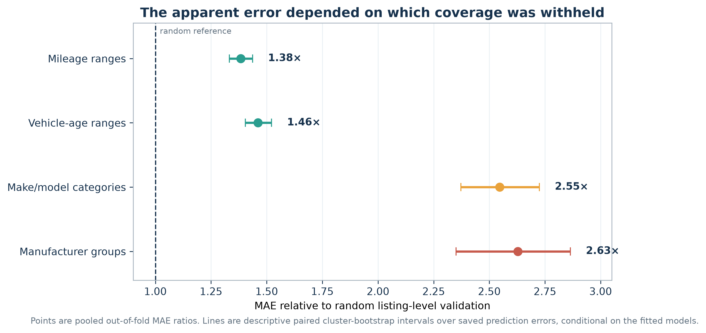

# Vehicle Asking-Price Model

This project estimates a vehicle's advertised asking price from details such as its make, model, year, mileage, trim, and condition. It returns both a point estimate and a price range, then compares a seller's asking price with that range.

The model learns from asking prices in marketplace listings, not completed sales. A “deal” or “overpriced” result only means low or high relative to similar listings in the collected sample.

The current model is version 13. It was trained on a private, cleaned snapshot of 20,801 listings. The current checkout does not contain the row-level dataset, but it does include the trained model, preprocessing code, aggregate results, and tests. Earlier development commits contain old marketplace-data snapshots and source URLs; those files are not part of the current release.

## Try the app

The saved model files are committed, so the app can run without the training data.
Use Python 3.12 or newer.

```bash
python3 -m venv .venv
source .venv/bin/activate
python -m pip install -r requirements.txt
python -m streamlit run src/app.py
```

On macOS, LightGBM may also need the OpenMP runtime. If it reports a missing `libomp.dylib`, install it with `brew install libomp` and rerun the app.

Open `http://localhost:8501`, enter a vehicle and asking price, and click **Estimate price**. The app shows the estimated price, an 80% target price range, and a warning when the selected model or trim had few training examples.

## How it works

The main pipeline has four stages:

1. `src/clean_raw_data.py` removes duplicate rows, missing required fields, impossible values, and obvious price-capture errors.
2. `src/preprocess_cars_data.py` normalizes text fields and builds model inputs such as vehicle age, miles per year, mileage range, combined make/model, and trim tier.
3. `src/train_price_model.py` trains LightGBM models on `log1p(price)`. One model produces the point estimate, while three quantile models produce the lower, middle, and upper estimates. Conformal calibration adjusts the final range.
4. `src/evaluate_model.py` compares the model with simple baselines and saves segment errors, calibration results, and SHAP feature importance.

`src/cars_com_browser_collect.py` is the browser collector used in the later collection phase. It reads fields visible in a loaded browser page, saves incrementally, and stops when the site returns a block page. The collected rows themselves are kept private.

The collector should only be used where automated access is permitted. Check the site's terms and robots rules first, keep request rates low, stop at any block, and do not redistribute collected rows.

## Current model results

Version 13 used a fixed 80/20 split: 16,640 training rows and 4,161 evaluation rows. Within that training run, the evaluation rows were not used for fitting, early stopping, calibration, or hyperparameter selection. The same split was reviewed across versions 10–13 and influenced feature selection during development, so the numbers below describe performance on a repeatedly consulted evaluation set rather than a one-time independent final test.

| Method | MAE | R² | MAPE |
|---|---:|---:|---:|
| LightGBM point model | $2,976 | 0.885 | 11.0% |
| Global median | $12,753 | -0.032 | 67.0% |
| Same make/model median | $9,049 | 0.573 | 49.7% |
| Linear depreciation baseline | $8,645 | 0.329 | 29.4% |

MAE is the average dollar error. MAPE is the average error as a percentage of the listing price. The q10–q90 range covered 79.1% of the fixed evaluation prices, close to its 80% target.

## Training-coverage checks

An ordinary random split usually tests the model on new listings from vehicle groups and numerical ranges that were already represented in training. I added a separate set of experiments to see what happens when complete categories or ranges are missing from training.

| Evaluation condition | MAE | Compared with random | MAPE |
|---|---:|---:|---:|
| Random listing-level reference | $3,015 | 1.00× | 10.9% |
| Complete mileage ranges withheld | $4,171 | 1.38× | 18.4% |
| Complete vehicle-age ranges withheld | $4,403 | 1.46× | 23.0% |
| Complete make/model categories withheld | $7,676 | 2.55× | 25.4% |
| Complete manufacturers withheld | $7,921 | 2.63× | 25.7% |



The experiment also compares selected ranges using the same test listings and the same number of training rows in both conditions. Code, design notes, aggregate tables, figures, and synthetic-data tests are in [`experiments/training_coverage/`](experiments/training_coverage/).

The 80/20 model result and the training-coverage table answer different questions, so their MAE values should not be treated as the same test.

Two preprocessing steps were applied before the 80/20 split: price-based outlier rules and rare-category grouping based on counts from the full processed table. The fixed evaluation split was also reviewed across several model versions. Its rows were not used to fit or calibrate version 13, but the reported metrics are not independent of the project’s earlier preprocessing and feature decisions.

## Running the pipeline

Place appropriately obtained input files in the paths described in [`data/README.md`](data/README.md), then run:

```bash
make data
make train
make evaluate
```

Training writes the current models and metadata to `model_artifacts/`. Older local snapshots are not included in the public checkout; their metrics are summarized in [`model_artifacts/MODEL_HISTORY.md`](model_artifacts/MODEL_HISTORY.md).

Run the root tests with:

```bash
make test
```

Run the training-coverage package checks with:

```bash
make coverage-test
make coverage-smoke
```

The smoke run uses generated data and checks that the experiment works end to end. It does not reproduce the saved numerical results.

## Repository layout

```text
src/                           collection, cleaning, modeling, evaluation, and app
tests/                         preprocessing and calibration tests
model_artifacts/               current trained model and aggregate evaluation files
experiments/training_coverage/ coverage experiments, tables, figures, and tests
data/                          local-data layout and availability notes
```

The exact training records are not distributed in the current checkout because they came from a third-party marketplace. A new dataset with the same fields can run through the code, but its results should be expected to differ from the saved results here.
