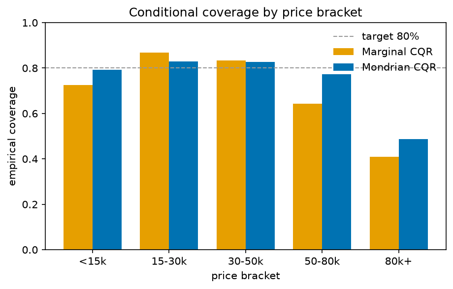
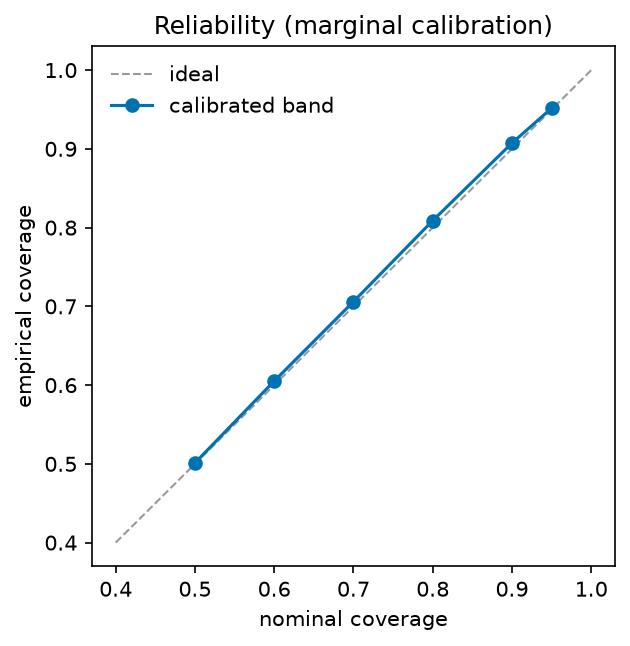
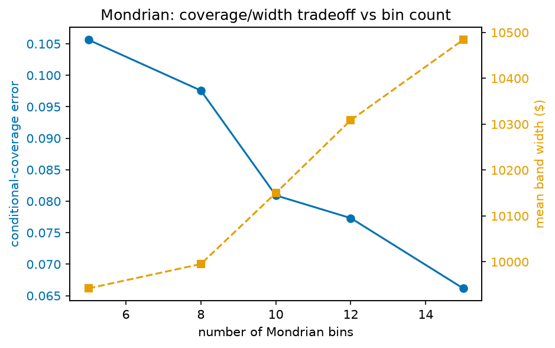
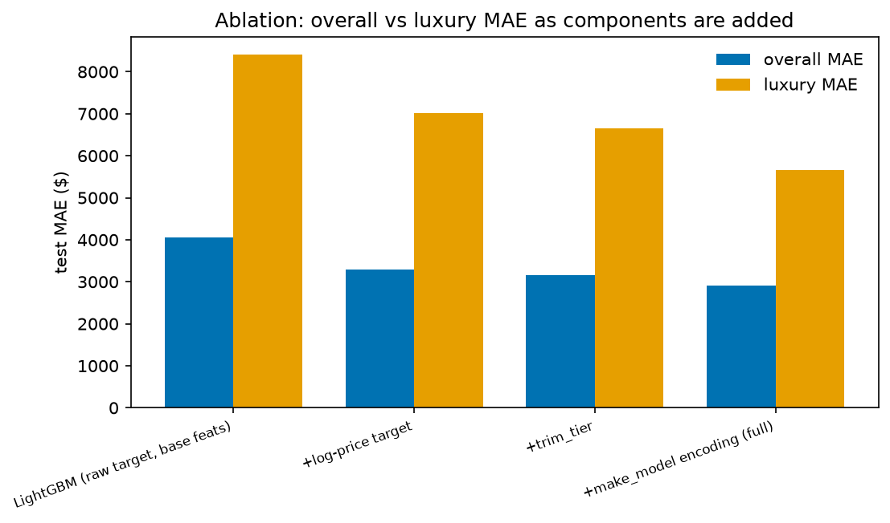
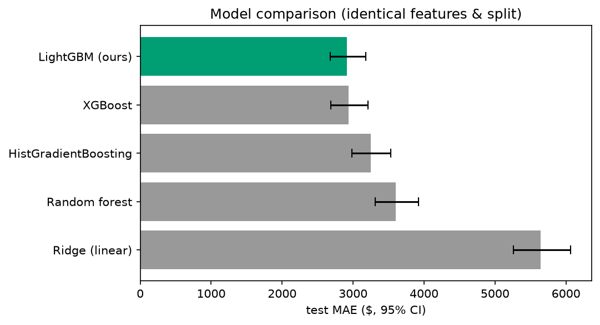
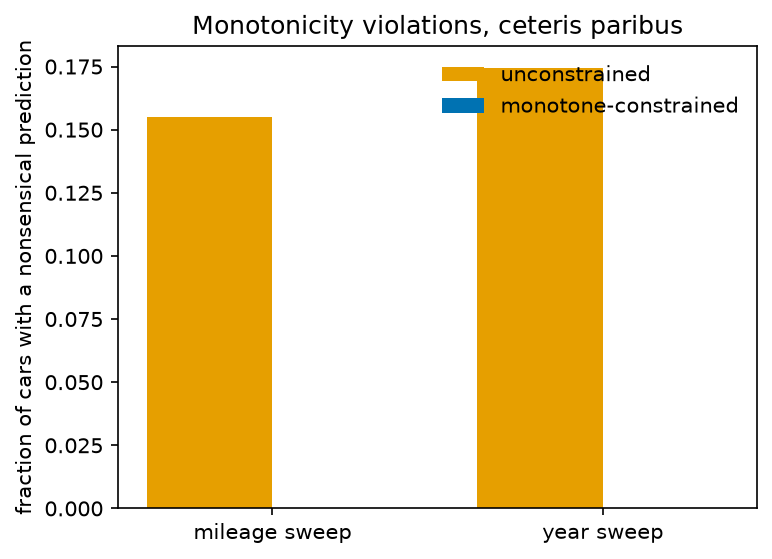
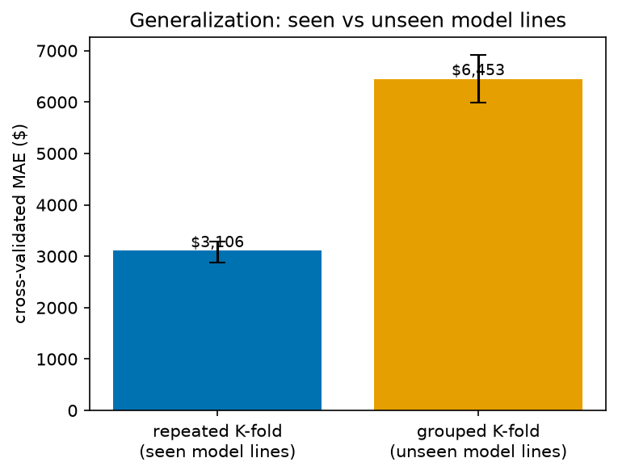
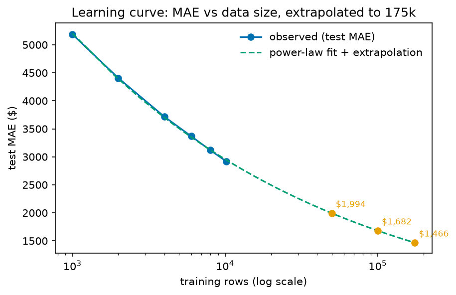

# CarPrice - Experimental Results

*Generated 2026-08-20 by `python3 -m experiments.run_all`. Every number is reproducible from the committed processed dataset (`data/processed/cars_com_processed.csv`) at a fixed seed.*

## 1. Setup

- **Task:** predict used-car asking price and a calibrated price *band*.
- **Model:** LightGBM on log1p(price); a mean point model plus q10/q50/q90 quantile models for the band.
- **Split:** 64% proper-train / 16% calibration / 20% test (seed 42). The calibration slice is unseen by the band models, so conformal coverage is a true out-of-sample estimate.
- **make_model target encoding** is fit on the proper-train slice only.

## 2. Group-conditional conformal prediction (headline)

Target coverage 80%; held-out test n = 2,548. *Conditional-coverage error* is the mean absolute gap between empirical and target coverage across the five price brackets, i.e. how far the band strays from target within each segment.

| Method | Overall coverage | Cond.-coverage error | Mean band width |
|---|---|---|---|
| Raw quantiles (uncalibrated) | 56.8% | 0.293 | $6,559 |
| Marginal CQR (prior production) | 80.9% | 0.145 | $9,736 |
| **Mondrian CQR (10 bins, ours)** | 81.2% | 0.081 | $10,150 |

Mondrian cuts conditional-coverage error from 0.145 (marginal) to 0.081 - a 44% reduction - while holding overall coverage at 81% and widening the band only 4%.

### Coverage by price bracket

| Price bracket | Marginal CQR | Mondrian CQR |
|---|---|---|
| <15k | 72.5% | 79.2% |
| 15-30k | 86.8% | 82.8% |
| 30-50k | 83.5% | 82.7% |
| 50-80k | 64.2% | 77.2% |
| 80k+ | 41.0% | 48.7% |

The $80k+ bracket remains the hardest even after Mondrian - a *data* limit (only ~40 six-figure test cars), which directly motivates the multi-site, ZIP3-partitioned collection expansion.

### Bin-count tradeoff

| Bins | Overall | Cond. err | $80k+ coverage | Mean width |
|---|---|---|---|---|
| 5 | 80.6% | 0.106 | 43.6% | $9,942 |
| 8 | 80.8% | 0.098 | 43.6% | $9,995 |
| 10 | 81.2% | 0.081 | 48.7% | $10,150 |
| 12 | 81.6% | 0.077 | 51.3% | $10,309 |
| 15 | 81.6% | 0.066 | 53.8% | $10,484 |

### Proper scoring rules

Coverage can be gamed by a very wide band; proper scoring rules reward calibration and sharpness together (lower is better). Mondrian has the lowest Winkler interval score; q50 pinball is unchanged because calibration adjusts the interval, not the median prediction.

| Method | Winkler interval score | Pinball (q50) |
|---|---|---|
| Raw quantiles | $19,162 | $1,445 |
| Marginal CQR | $17,493 | $1,445 |
| Mondrian CQR | $17,269 | $1,445 |

## 3. Ablation study

Each row adds one component on the identical split (test n = 2,548; 540 luxury). MAE/R² with bootstrap 95% CIs; luxury MAE shows where each component pays off.

| Component | MAE (95% CI) | R² | MAPE | Luxury MAE |
|---|---|---|---|---|
| baseline: global median | $11,836 [11,251, 12,445] | -0.022 | 82.2% | - |
| baseline: make/model median | $8,761 [8,339, 9,167] | 0.497 | 60.8% | - |
| LightGBM (raw target, base feats) | $4,049 [3,707, 4,422] | 0.730 | 17.7% | $8,402 |
| + log-price target | $3,285 [3,008, 3,590] | 0.822 | 13.6% | $7,017 |
| + trim_tier | $3,160 [2,905, 3,444] | 0.839 | 13.3% | $6,658 |
| + make_model encoding (full) | $2,911 [2,675, 3,176] | 0.867 | 12.7% | $5,668 |

## 4. Model comparison

Identical features, split, and log-price target (test n = 2,548); only the learner changes. ΔMAE vs LightGBM is a paired bootstrap on shared resamples with a two-sided p-value.

| Model | MAE (95% CI) | R² | MAPE | ΔMAE vs ours (p) |
|---|---|---|---|---|
| LightGBM (ours) | $2,914 [2,677, 3,176] | 0.865 | 12.8% | - (reference) |
| XGBoost | $2,936 [2,688, 3,209] | 0.851 | 12.4% | +$22 (p=0.722) |
| HistGradientBoosting | $3,250 [2,980, 3,529] | 0.836 | 13.5% | +$336 (p=0.000) |
| Random forest | $3,599 [3,315, 3,924] | 0.811 | 15.0% | +$685 (p=0.000) |
| Ridge (linear) | $5,640 [5,262, 6,062] | 0.633 | 23.0% | +$2,727 (p=0.000) |

## 5. Economic monotonicity

A gradient-boosted model has no built-in reason to obey depreciation, and it doesn't. On a ceteris-paribus counterfactual (move one feature, hold the rest fixed) the unconstrained model raises the predicted price of 15.5% of test cars when only their mileage increases, and lowers it for 17.4% when only their model year increases. Neither makes sense to a buyer. LightGBM monotone constraints (price non-increasing in mileage and prior owners, non-decreasing in year) remove them entirely, with no accuracy cost.

| | Mileage-↑ violations | Year-↑ violations | MAE | R² | MAPE |
|---|---|---|---|---|---|
| Unconstrained | 15.5% | 17.4% | $2,914 | 0.865 | 12.8% |
| **Monotone-constrained** | **0.0%** | **0.0%** | $2,910 | 0.856 | 12.7% |

The constrained model is the production default (v9). Constraining the collinear derived features (car_age, miles_per_year) or the learned signals (target encoding, trim tier) instead *over*-regularizes and costs real accuracy, so only the three unarguable depreciation directions are constrained.

## 6. Robustness & generalization

Two checks beyond the single split (12,739 rows, 612 make_models; encoding re-fit inside every fold).

- Across repeated 5-fold x3 cross-validation, mean MAE was $3,106; the empirical 2.5th-97.5th percentile range across the 15 fold MAEs was $2,878-$3,286. This describes split-to-split variation, not a confidence interval.
- make_model-grouped 5-fold CV holds every listing of a model line out together, so test folds are unseen model lines: MAE rises to $6,453, a +$3,347 penalty for a model line the training set has never seen.

This bounds what the model does: it interpolates within known make_models and is much weaker on entirely new ones, where the target encoding falls back to its prior. It's also a second argument for collecting more data, since more listings mean fewer unseen model lines at prediction time.

## 7. Data-scaling: is more data worth collecting?

Test MAE vs training size (5 seeds each; encoding re-fit inside each subsample to avoid leakage). The curve has **not plateaued** at the full 10,191-row dataset, so more data still helps materially.

| Training rows | Test MAE | Luxury MAE |
|---|---|---|
| 1,000 | $5,187 | $10,376 |
| 2,000 | $4,407 | $8,964 |
| 4,000 | $3,719 | $7,669 |
| 6,000 | $3,369 | $6,884 |
| 8,000 | $3,118 | $6,329 |
| 10,191 | $2,918 | $5,814 |

A power-law fit MAE(n) = 28,310·n^−0.245 + 0 extrapolates to:

| Target size | Projected MAE |
|---|---|
| 50,000 rows | ~$1,994 |
| 100,000 rows | ~$1,682 |
| 175,000 rows | ~$1,466 |

Extrapolation beyond the observed range is uncertain (and the fitted floor is optimistic), but the direction is unambiguous: scaling collection toward the planned ~175k rows should roughly halve the error. **This is the quantitative case for the multi-site, ZIP3-stratified collection expansion.**

## 8. Summary of findings

1. Group-conditional (Mondrian) conformal prediction reduces measured coverage imbalance across price ranges and lowers the Winkler interval score, but the highest-price segment remains under-covered.
2. Each modeling component lowers error in the ablation, with most of the gain in the luxury segment (luxury MAE drops monotonically down the table).
3. LightGBM is within noise of XGBoost (paired test p=0.72) and clearly ahead of random forest, HistGBM, and Ridge.
4. The monotone constraints remove the nonsensical mileage/year predictions (15.5%/17.4% down to 0) with no measurable accuracy cost.
5. On unseen model lines (grouped CV) MAE roughly doubles, so the model interpolates within known make_models rather than extrapolating to new ones.
6. The learning curve has not flattened; the power-law fit projects roughly half the current MAE at the ~175k-row collection target, which together with the unseen-model penalty is the case for the multi-site / ZIP3 expansion.
